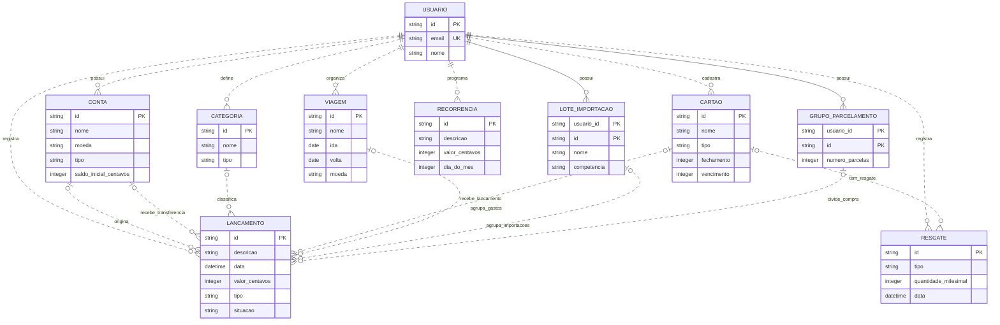
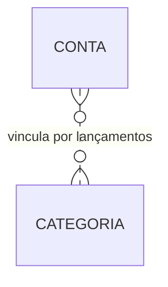

# Modelo de dados do Fluxo

O Fluxo registra movimentações financeiras por usuário. O modelo deriva do MER simplificado. Toda a estrutura, incluindo as chaves, os índices, a visão, a função, a procedure e os gatilhos, é criada em um único script. [01-banco.sql](../database/01-banco.sql)

## Modelo conceitual

O diagrama destaca o núcleo financeiro e os seus atributos de negócio. A tabela de mapeamento abaixo detalha os demais atributos e entidades.

Uma conta pode ter despesas em várias categorias. A mesma categoria pode aparecer em despesas de várias contas. Essa relação N:M é registrada em `transactions`, uma linha por lançamento.

Leia a cardinalidade de cada lado da relação. Em **Usuário possui Conta**, um usuário pode começar com zero contas, mas cada conta precisa de um usuário. `0..N` indica zero ou muitos, `0..1` indica zero ou um e `1..1` indica exatamente um.

| Relacionamento | Participação e cardinalidade |
|---|---|
| Usuário possui conta (1:N) | Um usuário pode ter `0..N` contas. Cada conta tem `1..1` usuário. O mesmo padrão vale para categorias, cartões, viagens, lançamentos, recorrências, resgates, lotes, grupos de parcelamento, regras, capturas, sessões web, aparelhos, inscrições push, mutações, uso diário de IA, nomes de parcelamento e avisos. Cada feedback tem `1..1` usuário remetente. |
| Conta e categoria (N:M) | Uma conta pode ter lançamentos de `0..N` categorias. Uma categoria pode classificar lançamentos de `0..N` contas. `transactions` representa essa associação e guarda data, valor e descrição do movimento. A combinação conta/categoria pode aparecer várias vezes, identificada por `transactions.id`. |
| Lançamento tem conta de origem e de destino | Cada conta pode aparecer como origem em `0..N` lançamentos e como destino em `0..N`. Cada lançamento tem `0..1` conta de origem, `0..1` conta de destino e `0..1` categoria. A transferência exige duas contas distintas, uma em cada papel. |
| Cartão tem lançamentos, recorrências, resgates, regras e capturas | Cada cartão pode ter `0..N` registros de cada tipo. Cada registro pode apontar para `0..1` cartão no banco. A interface exige o cartão na criação de um resgate. |
| Viagem, lote e grupo agrupam lançamentos | Uma viagem, um lote ou um grupo pode agrupar `0..N` lançamentos. Cada lançamento pertence a `0..1` viagem, `0..1` lote e `0..1` grupo. |
| Grupo de parcelamento tem rótulo | Cada rótulo pertence a `1..1` grupo. O banco admite `0..N` rótulos por grupo. A API permite até um. |
| Conta é vinculada a cartão, recorrência, resgate, regra ou captura | A conta pode aparecer em `0..N` registros de cada tipo. O vínculo é `0..1` em cada registro. Para cartão de débito, a aplicação exige conta vinculada. |
| Categoria é sugerida ou definida por regra | A categoria pode aparecer em `0..N` recorrências, regras e capturas. A aplicação exige uma categoria em cada regra de estabelecimento e permite `0..1` nas demais. |
| Feedback gera aviso | Um feedback pode originar `0..N` avisos. Cada aviso pode se referir a `0..1` feedback. |
| Usuário tem perfil | Cada usuário pode ter `0..1` perfil adicional. Cada perfil pertence a `1..1` usuário. |
| Lançamento gera auditoria | Cada evento pertence a `1..1` lançamento. A FK admite `0..N` eventos por lançamento. Os gatilhos registram o primeiro evento na inclusão e acrescentam um a cada alteração. |

## Modelo relacional

Uma seta identifica o destino de uma chave estrangeira (FK). Parênteses delimitam chaves compostas. `UNIQUE` indica uma restrição adicional de unicidade. As colunas `*_cents`, `*_milli` e `*_micros` guardam inteiros escalados, respectivamente em centavos, milésimos e milionésimos.

### Núcleo financeiro

| Tabela | Chave primária (PK) e unicidade | Chaves estrangeiras (FK) | Demais atributos |
|---|---|---|---|
| `users` | `id` · `UNIQUE(email)` | — | `email`, `display_name`, `password_hash`, `password_salt`, `password_iterations`, `created_at`, `updated_at` |
| `accounts` | `id` · `UNIQUE(owner_id, id)` | `owner_id` → `users.id` | `name`, `institution`, `currency_code`, `kind`, `balance_cents`, `goal_cents`, `monthly_yield_basis_points`, `fixed`, `exclude_from_totals`, `color`, `created_at`, `updated_at` |
| `categories` | `id` · `UNIQUE(owner_id, id)` | `owner_id` → `users.id` | `name`, `kind`, `color`, `icon`, `essential`, `created_at` |
| `cards` | `id` | `owner_id` → `users.id` | `name`, `linked_account`, `kind`, `brand`, `tier`, `last4`, `limit_cents`, `closing_day`, `due_day`, `due_adjustment`, `points_per_dollar_milli`, `cashback_basis_points`, `reward_mode`, `points_goal`, `manual_usd_rate_micros`, `color`, `image_data`, `is_favorite`, `sort_order`, `created_at`, `updated_at` |
| `trips` | `id` | `owner_id` → `users.id` | `name`, `start_date`, `end_date`, `currency`, `exchange_rate_micros`, `created_at`, `updated_at` |
| `transactions` | `id` | `owner_id` → `users.id`, `card_id` → `cards.id`, `trip_id` → `trips.id`, `(owner_id, account)` e `(owner_id, destination_account)` → `accounts(owner_id, id)`, `(owner_id, category)` → `categories(owner_id, id)`, `(owner_id, import_batch_id)` → `import_batches(owner_id, id)`, `(owner_id, installment_group_id)` → `installment_groups(owner_id, id)` | `description`, `occurred_at`, `amount_cents`, `type`, `status`, `source`, `payment_method`, `invoice_month`, `reward_points_milli`, `reward_cashback_cents`, `reward_usd_rate_micros`, `fingerprint`, `version`, `deleted_at`, `device_id`, `last_mutation_id`, `auto_imported`, `review_status`, `source_app`, `raw_text`, `confidence`, `created_at`, `updated_at` |
| `recurring_entries` | `id` | `owner_id` → `users.id`, `card_id` → `cards.id` | `description`, `category`, `account`, `amount_cents`, `type`, `day_of_month`, `calculation_mode`, `schedule_mode`, `date_adjustment`, `payment_method`, `active`, `last_confirmed_month`, `created_at`, `updated_at` |
| `reward_redemptions` | `id` | `owner_id` → `users.id`, `card_id` → `cards.id` | `kind`, `amount_milli`, `account`, `redeemed_at`, `note`, `created_at` |
| `import_batches` | `(owner_id, id)` | `owner_id` → `users.id` | `name`, `month`, `imported_at` |
| `installment_groups` | `(owner_id, id)` | `owner_id` → `users.id` | `installments`, `created_at` |
| `installment_labels` | `id` | `owner_id` → `users.id`, `(owner_id, group_id)` → `installment_groups(owner_id, id)` | `label`, `updated_at` |
| `transaction_audit` | `id` | `transaction_id` → `transactions.id` | `action`, `previous_amount_cents`, `amount_cents`, `previous_deleted_at`, `deleted_at`, `audited_at` |

### Automação, autenticação e suporte

| Tabela | Chave primária (PK) e unicidade | Chaves estrangeiras (FK) | Demais atributos |
|---|---|---|---|
| `establishment_rules` | `id` | `owner_id` → `users.id` | `match_text`, `category`, `created_at` |
| `notification_app_rules` | `id` | `owner_id` → `users.id`, `account_id` → `accounts.id`, `card_id` → `cards.id` | `source_app`, `action`, `default_category`, `created_at` |
| `pending_auto_transactions` | `id` | `owner_id` → `users.id`, `card_id` → `cards.id` | `source_app`, `raw_text`, `confidence`, `description`, `amount_cents`, `type`, `occurred_at`, `suggested_category`, `suggested_account`, `review_status`, `ignore_reason`, `created_at` |
| `ai_usage_daily` | `id` · `UNIQUE(owner_id, feature, usage_day)` | `owner_id` → `users.id` | `feature`, `usage_day`, `request_count`, `updated_at` |
| `auth_rate_limits` | `key_hash` | — | `scope`, `failures`, `window_started_at`, `blocked_until`, `updated_at` |
| `web_sessions` | `id` | `user_id` → `users.id` | `token_hash`, `expires_at`, `revoked_at`, `last_seen_at`, `created_at`, `updated_at` |
| `mobile_devices` | `id` · `UNIQUE(owner_id, device_id)` | `owner_id` → `users.id` | `device_id`, `name`, `platform`, `app_version`, `token_hash`, `expires_at`, `revoked_at`, `last_seen_at`, `created_at`, `updated_at` |
| `push_subscriptions` | `id` | `owner_id` → `users.id` | `device_id`, `expo_push_token`, `platform`, `active`, `last_registered_at`, `created_at`, `updated_at` |
| `sync_mutations` | `id` · `UNIQUE(owner_id, mutation_id)` | `owner_id` → `users.id` | `mutation_id`, `device_id`, `entity_type`, `entity_id`, `operation`, `status`, `response_json`, `created_at` |
| `developer_feedback` | `id` | `sender_owner_id` → `users.id` | `sender_name`, `message`, `status`, `developer_comment`, `created_at`, `updated_at` |
| `app_notifications` | `id` | `owner_id` → `users.id`, `feedback_id` → `developer_feedback.id` | `kind`, `title`, `message`, `read_at`, `created_at` |
| `user_profiles` | `owner_id` | `owner_id` → `users.id` | `avatar_data`, `updated_at` |

A API valida referências que o MER original armazenava sem FK, como `cards.linked_account`, `recurring_entries.account` e `pending_auto_transactions.suggested_category`. A tabela `user_profiles` usa `owner_id` como chave de identificação do usuário. A coluna `transactions.source_app` guarda a origem registrada na captura, quando aplicável.

## Normalização até a 3FN

1. **Primeira forma normal (1FN).** Cada coluna guarda um valor. Uma compra de três parcelas gera três linhas de lançamento, cada uma com data, valor e situação próprios.
2. **Segunda forma normal (2FN).** Os atributos de um lote ou grupo dependem da chave completa `(owner_id, id)`. O mesmo identificador local pode existir para usuários diferentes.
3. **Terceira forma normal (3FN).** Cada fato é armazenado na entidade da qual depende. O nome da conta pertence a `accounts`, o da categoria a `categories` e o lançamento guarda as referências. Valores históricos, como a taxa usada para calcular pontos, pertencem ao evento em que foram registrados.

O nome, a competência e a data de importação pertencem ao lote. Repeti-los em `transactions` criaria a dependência transitiva `id do lançamento → chave do lote → nome, competência e data`. Por isso, `import_batches` guarda esses dados uma vez e cada lançamento aponta para o seu lote. Corrigir o nome exige atualizar uma única linha.

Em `installment_groups`, uma linha guarda a quantidade total de parcelas. As três parcelas de **Passagens para Curitiba** no conjunto de demonstração apontam para o mesmo grupo. Cada parcela guarda a própria data e o próprio valor. A visão `vw_lancamentos` recupera a quantidade com `LEFT JOIN`, mostra uma parcela nos lançamentos avulsos e calcula o valor com sinal por meio da função `fn_valor_movimento`. [02-dados-demo.sql](../database/02-dados-demo.sql)
