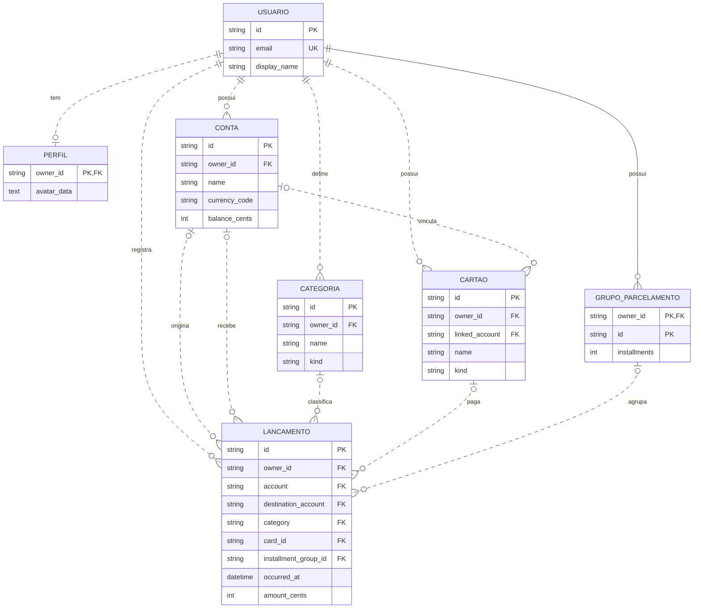

# Modelo de dados do Fluxo Pessoal

O banco organiza contas, categorias, cartões e lançamentos por titular. Cada transferência ocupa uma linha com conta de origem e de destino. Cada parcela também tem uma linha, vinculada ao grupo que guarda a quantidade total. [Banco](../database/01-banco.sql)

## Modelo conceitual

- **Usuário e perfil (1:1).** O perfil é opcional para o usuário. Quando existe, pertence a um único usuário.
- **Usuário e cadastros (1:N).** Cada conta, categoria, cartão, lançamento ou grupo tem um titular. Um usuário pode começar sem registros e cadastrar vários depois.
- **Contas de origem e destino (1:N).** Uma conta pode aparecer em vários lançamentos em cada papel. Um lançamento pode ter até uma origem e um destino. A procedure de transferência exige duas contas distintas do titular e da mesma moeda.
- **Cartão, categoria e grupo (1:N).** Cada um pode aparecer em muitos lançamentos. Um lançamento pode apontar para um registro de cada tipo. Cada cartão também pode apontar para uma conta, que pode estar vinculada a vários cartões.
- **Conta e categoria (N:M).** Uma conta pode ter lançamentos em várias categorias, e uma categoria pode classificar lançamentos de diferentes contas do mesmo titular. `transactions` faz a associação. O mesmo par pode aparecer em vários lançamentos com datas ou valores diferentes.

## Modelo relacional

| Tabela | Chave primária e unicidade | Chaves estrangeiras | Atributos principais |
| --- | --- | --- | --- |
| `users` | `id`, e-mail único | — | `email`, `display_name`, `password_hash`, `password_salt`, `password_iterations` |
| `user_profiles` | `owner_id` | `owner_id` → `users.id` | `avatar_data`, `updated_at` |
| `accounts` | `id`, par `(owner_id, id)` único | `owner_id` → `users.id` | `name`, `institution`, `kind`, `currency_code`, `balance_cents`, `goal_cents` |
| `categories` | `id`, par `(owner_id, id)` único | `owner_id` → `users.id` | `name`, `kind`, `color`, `icon`, `essential` |
| `cards` | `id`, par `(owner_id, id)` único | `owner_id` → `users.id`, `(owner_id, linked_account)` → `accounts(owner_id, id)` | `name`, `kind`, `brand`, `limit_cents`, `closing_day`, `due_day` |
| `installment_groups` | `(owner_id, id)` | `owner_id` → `users.id` | `installments`, `created_at` |
| `transactions` | `id` | `owner_id` → `users.id`, `(owner_id, account)` e `(owner_id, destination_account)` → `accounts(owner_id, id)`, `(owner_id, category)` → `categories(owner_id, id)`, `(owner_id, card_id)` → `cards(owner_id, id)`, `(owner_id, installment_group_id)` → `installment_groups(owner_id, id)` | `description`, `occurred_at`, `amount_cents`, `type`, `status`, `invoice_month` |

As chaves estrangeiras compostas incluem o titular e o ID do cadastro. Isso impede vincular um lançamento a dados de outro usuário. O banco guarda valores em centavos e exige valor positivo no lançamento. A função `fn_valor_movimento` calcula o sinal para a conta de origem. A DDL lista também campos opcionais de configuração e controle. [Banco](../database/01-banco.sql)

## Normalização até a 3FN

1. **1FN.** Cada campo guarda um valor. Uma compra em duas parcelas gera duas linhas com data e valor próprios.
2. **2FN.** A quantidade de parcelas depende da chave inteira `(owner_id, id)` de `installment_groups`. O ID de um grupo pode ser reutilizado por titulares diferentes.
3. **3FN.** O nome da categoria depende do cadastro da categoria. A quantidade total de parcelas depende do grupo. O lançamento guarda referências e os dados próprios do movimento. A visão recupera a quantidade do grupo, e a consulta do extrato recupera o nome da categoria por junção. [Banco](../database/01-banco.sql) · [Consultas](../database/03-consultas-demo.sql)
